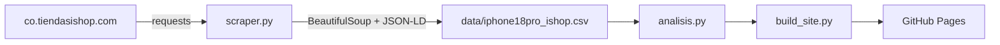

# Precios del iPhone 18 Pro y 18 Pro Max en iShop Colombia

[](https://github.com/camilolondono-IUD/scraping-iphone-ishop/actions/workflows/ci-cd.yml)
[](https://camilolondono-iud.github.io/scraping-iphone-ishop/)

Proyecto de web scraping con **BeautifulSoup** que extrae las 32 variantes (2 modelos ×
4 capacidades × 4 colores) del iPhone 18 Pro y 18 Pro Max publicadas en
[iShop Colombia](https://co.tiendasishop.com), con su SKU, precio y disponibilidad.

Proyecto académico de la asignatura **Programación para Análisis de Datos** (IU Digital):
la Evidencia 1 construyó el scraper en Google Colab y la Evidencia 2 lo lleva a Git y
GitHub con un pipeline CI/CD en **GitHub Actions** (pruebas automatizadas y despliegue
continuo en GitHub Pages). Uso exclusivamente educativo.

- **Sitio publicado:** <https://camilolondono-iud.github.io/scraping-iphone-ishop/>
- **Explicación del flujo DevOps:** [docs/DEVOPS.md](docs/DEVOPS.md)

## Arquitectura

```
notebooks/      Notebook original de la Evidencia 1 (Google Colab)
src/
  scraper.py    Descarga HTTP (requests) separada del parseo (BeautifulSoup, funciones puras)
  analisis.py   Limpieza, tabla de precios, disponibilidad y resumen (pandas)
  build_site.py Genera el sitio estático con resultados, tabla y gráfico (matplotlib)
tests/          Pruebas unitarias con pytest
  fixtures/     HTML real guardado de iShop (las pruebas no hacen peticiones al sitio)
data/           CSV con los resultados de la Evidencia 1
docs/DEVOPS.md  Estrategia de ramas, commits, pipeline y despliegue
.github/workflows/ci-cd.yml  Pipeline CI/CD
```



## Instalación

Requiere Python 3.10 o superior.

```bash
git clone https://github.com/camilolondono-IUD/scraping-iphone-ishop.git
cd scraping-iphone-ishop
python -m venv .venv
# Windows: .venv\Scripts\activate   ·   Linux/macOS: source .venv/bin/activate
pip install -r requirements-dev.txt
```

## Uso

```bash
# 1. Volver a extraer los datos del sitio (hace ~35 peticiones con pausas de 1,5 s)
python -m src.scraper

# 2. Generar el sitio con los resultados en la carpeta site/
python -m src.build_site --datos data/iphone18pro_ishop.csv --salida site
```

## Pruebas

```bash
ruff check .                                     # linting
pytest --cov=src --cov-report=term-missing       # pruebas + cobertura
```

Las pruebas usan HTML real de iShop guardado en `tests/fixtures/`, así que funcionan sin
internet y no generan tráfico al sitio. Cubren el parseo de la colección y de la ficha,
el descubrimiento de las 32 variantes, casos de precio ausente o mal formateado, el
formato colombiano de precios, los reintentos de red y la generación del sitio.

## CI/CD

Cada push y cada pull request hacia `main` ejecuta el workflow
[`ci-cd.yml`](.github/workflows/ci-cd.yml):

| Job | Qué hace | Cuándo |
| --- | --- | --- |
| `test` | ruff + pytest con cobertura | Siempre |
| `build` | Genera el sitio y lo sube como artefacto de Pages | Si `test` pasa |
| `deploy` | Publica el sitio en GitHub Pages | Solo en push a `main` |

## Buenas prácticas de scraping

Solo se consultan páginas permitidas por el `robots.txt` de iShop (colección y fichas, sin
parámetros, carrito ni checkout), con una pausa de 1,5 s entre peticiones y reintentos
limitados.

## Autor

Camilo Londoño Acebedo · IU Digital · Programación para Análisis de Datos (PREICA2602B020048)
