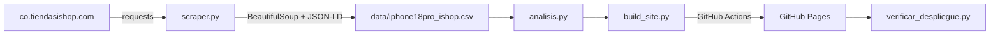

# Precios del iPhone 18 Pro y 18 Pro Max en iShop Colombia

[](https://github.com/camilolondono-IUD/scraping-iphone-ishop/actions/workflows/ci-cd.yml)
[](https://camilolondono-iud.github.io/scraping-iphone-ishop/)

**Aplicación publicada:** <https://camilolondono-iud.github.io/scraping-iphone-ishop/>

## Contenido

1. [Introducción](#introducción)
2. [Arquitectura del proyecto](#arquitectura-del-proyecto)
3. [Instalación](#instalación)
4. [Uso](#uso)
5. [Pruebas](#pruebas)
6. [Automatización con GitHub Actions](#automatización-con-github-actions)
7. [Despliegue](#despliegue)
8. [Flujo de trabajo y evolución del proyecto](#flujo-de-trabajo-y-evolución-del-proyecto)
9. [Autor](#autor)

## Introducción

Proyecto de web scraping con **BeautifulSoup** que extrae las 32 variantes (2 modelos ×
4 capacidades × 4 colores) del iPhone 18 Pro y 18 Pro Max publicadas en
[iShop Colombia](https://co.tiendasishop.com), con su SKU, precio y disponibilidad, y las
publica en una **aplicación web** con indicadores, gráfico y filtros interactivos.

El proyecto se construye en la asignatura **Programación para Análisis de Datos** (IU Digital)
y se automatiza con un pipeline **CI/CD en GitHub Actions**: cada cambio pasa por linting y
pruebas, y cada merge a `main` se despliega en **GitHub Pages** y se verifica automáticamente.
Uso exclusivamente educativo.

## Arquitectura del proyecto

```
notebooks/                    Notebooks de Google Colab (Evidencia 1 y Evidencia 3)
src/
  scraper.py                  Descarga HTTP (requests) separada del parseo (BeautifulSoup)
  analisis.py                 Limpieza, tabla de precios, disponibilidad y resumen (pandas)
  build_site.py               Genera la aplicación web: index.html, datos.json, version.json
scripts/
  verificar_despliegue.py     Prueba de humo contra la URL publicada
tests/                        Pruebas unitarias con pytest
  fixtures/                   HTML real guardado de iShop (las pruebas no usan internet)
data/iphone18pro_ishop.csv    Datos extraídos con el scraper
docs/
  AUTOMATIZACION.md           El pipeline de GitHub Actions paso a paso
  DESPLIEGUE.md               Entorno, variables, configuración de Pages y rollback
  DEVOPS.md                   Estrategia de ramas, commits y flujo DevOps
.github/workflows/ci-cd.yml   Pipeline CI/CD (comentado línea por línea)
```



## Instalación

Requisitos: Python 3.10 o superior y Git.

```bash
git clone https://github.com/camilolondono-IUD/scraping-iphone-ishop.git
cd scraping-iphone-ishop
python -m venv .venv
# Windows: .venv\Scripts\activate   ·   Linux/macOS: source .venv/bin/activate
pip install -r requirements-dev.txt
```

## Uso

```bash
# 1. (Opcional) Volver a extraer los datos del sitio: ~35 peticiones con pausas de 1,5 s
python -m src.scraper

# 2. Generar la aplicación web en la carpeta site/
python -m src.build_site --datos data/iphone18pro_ishop.csv --salida site

# 3. Verla en el navegador
python -m http.server 8000 --directory site      # abrir http://localhost:8000

# 4. (Opcional) Verificar el sitio publicado
python scripts/verificar_despliegue.py --url https://camilolondono-iud.github.io/scraping-iphone-ishop/ --variantes 32
```

La aplicación muestra el entorno y la versión (`APP_ENV`, `APP_VERSION`), los indicadores,
el gráfico de precios, las variantes agotadas y la tabla completa con **filtros** por modelo,
capacidad, color, disponibilidad y SKU. Los datos también están en `datos.json`.

## Pruebas

```bash
ruff check .                                              # linting
pytest --cov=src --cov=scripts --cov-report=term-missing  # pruebas + cobertura
```

39 pruebas cubren el scraper (con HTML real guardado), el análisis, la generación de la
aplicación, las variables de entorno y la verificación del despliegue (con un servidor simulado).

## Automatización con GitHub Actions

El workflow [`.github/workflows/ci-cd.yml`](.github/workflows/ci-cd.yml) se ejecuta en cada
push y pull request hacia `main`:

| Job | Qué hace | Cuándo |
| --- | --- | --- |
| `test` – Pruebas y linting | ruff + pytest con cobertura | Siempre |
| `build` – Generar sitio | Genera la app con `APP_ENV` y `APP_VERSION`, comprueba los archivos y los empaqueta | Si `test` pasa |
| `deploy` – Desplegar en GitHub Pages | Publica el artefacto en el entorno `github-pages` | Solo en push a `main` |
| `verificar` – Verificar despliegue | Prueba de humo contra la URL pública | Después de `deploy` |

Explicación detallada de cada paso, configuración y comando: **[docs/AUTOMATIZACION.md](docs/AUTOMATIZACION.md)**.

## Despliegue

La aplicación se aloja en **GitHub Pages** (Settings > Pages > Source: *GitHub Actions*) y se
configura con variables del repositorio:

| Variable | Valor | Uso |
| --- | --- | --- |
| `APP_ENV` | `produccion` | Entorno que muestra la app |
| `APP_VERSION` | `1.1.0` | Versión publicada |

Entorno, variables, permisos, verificación y cómo revertir un despliegue:
**[docs/DESPLIEGUE.md](docs/DESPLIEGUE.md)**.

## Flujo de trabajo y evolución del proyecto

Se trabaja con **GitHub Flow** (rama corta → pull request → CI en verde → merge a `main`) y
commits en formato **Conventional Commits**; `main` está protegida. Detalle en
[docs/DEVOPS.md](docs/DEVOPS.md).

| Versión | Evidencia | Cambios principales |
| --- | --- | --- |
| — | EA1 | Scraper en Google Colab con requests y BeautifulSoup |
| v1.0.0 | EA2 | Repositorio, pruebas, pipeline CI/CD y sitio en GitHub Pages |
| v1.1.0 | EA3 | App con filtros, variables de entorno, prueba de humo y documentación del pipeline |

## Buenas prácticas de scraping

Solo se consultan páginas permitidas por el `robots.txt` de iShop (colección y fichas, sin
parámetros, carrito ni checkout), con una pausa de 1,5 s entre peticiones y reintentos limitados.

## Autor

Camilo Londoño Acebedo · IU Digital · Programación para Análisis de Datos (PREICA2602B020048)
