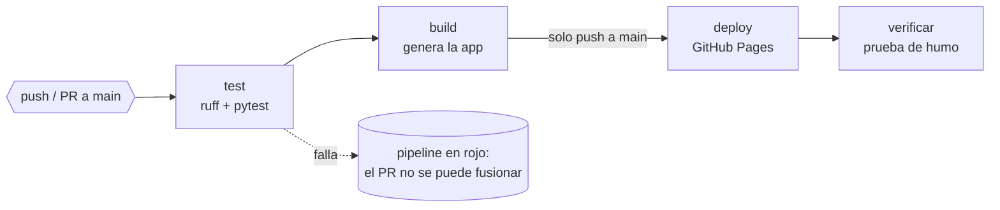

# Automatización con GitHub Actions

Este documento explica, paso a paso, el pipeline CI/CD definido en
[`.github/workflows/ci-cd.yml`](../.github/workflows/ci-cd.yml): qué ejecuta cada job, con qué
configuración y con qué comandos. El archivo del workflow también está comentado línea por línea.

## 1. Visión general



| Etapa | Tipo | Objetivo |
| --- | --- | --- |
| `test` | Integración continua | Que ningún cambio con errores de estilo o pruebas fallidas llegue a `main` |
| `build` | Integración continua | Que la aplicación se pueda generar y tenga todos sus archivos |
| `deploy` | Despliegue continuo | Publicar automáticamente cada versión estable |
| `verificar` | Despliegue continuo | Confirmar que lo publicado es lo esperado y responde |

## 2. Eventos que disparan el pipeline

```yaml
on:
  push:
    branches: [main]      # merge o push a main → CI + despliegue
  pull_request:
    branches: [main]      # PR hacia main → solo CI
  workflow_dispatch:      # ejecución manual (Actions > CI/CD > Run workflow)
```

- En un **pull request** corren `test` y `build`. El resultado aparece en el PR y, como `main`
  está protegida, el botón de merge queda bloqueado si `Pruebas y linting` falla.
- En un **push a `main`** (que en la práctica es el merge de un PR) corren los cuatro jobs.

## 3. Configuración global

| Configuración | Valor | Por qué |
| --- | --- | --- |
| `permissions: contents: read` | Solo lectura | Principio de mínimo privilegio para el `GITHUB_TOKEN` |
| `concurrency` | `ci-cd-<rama>`, cancela la anterior | Evita ejecuciones duplicadas si llegan varios pushes seguidos |
| `env.PYTHON_VERSION` | `3.12` | Una sola versión de Python para todos los jobs |
| `env.URL_SITIO` | URL de GitHub Pages | Respaldo para la verificación |

## 4. Job `test` – Pruebas y linting

| Paso | Comando / acción | Qué hace |
| --- | --- | --- |
| Descargar el código | `actions/checkout@v7` | Clona el repositorio en el commit que disparó el pipeline |
| Configurar Python | `actions/setup-python@v7` con `cache: pip` | Instala Python 3.12 y reutiliza la caché de paquetes (se invalida si cambian `requirements*.txt`) |
| Instalar dependencias | `pip install -r requirements-dev.txt` | requests, BeautifulSoup, pandas, matplotlib, pytest, pytest-cov y ruff con versiones fijas |
| Linting | `ruff check .` | Revisa estilo, imports y errores comunes según `pyproject.toml` |
| Pruebas | `pytest --cov=src --cov=scripts --cov-report=term-missing` | Ejecuta las 39 pruebas e informa la cobertura línea por línea |

Las pruebas **no hacen peticiones a iShop**: leen HTML real guardado en `tests/fixtures/`.
Así el pipeline es rápido, reproducible y no depende de que el sitio esté disponible.

## 5. Job `build` – Generar sitio

`needs: test` → solo corre si las pruebas pasaron.

```yaml
env:
  APP_ENV: ${{ github.event_name == 'pull_request' && 'pull-request' || vars.APP_ENV || 'produccion' }}
  APP_VERSION: ${{ vars.APP_VERSION || 'dev' }}
```

- `vars.APP_ENV` y `vars.APP_VERSION` son **variables del repositorio**
  (Settings > Secrets and variables > Actions > Variables). Ver [DESPLIEGUE.md](DESPLIEGUE.md).
- En un PR el entorno se marca como `pull-request`; en `main`, toma el valor de la variable.
- Si la variable no existe, se usa el valor por defecto (`produccion`, `dev`).

| Paso | Comando / acción | Qué hace |
| --- | --- | --- |
| Generar la aplicación | `python -m src.build_site --datos data/iphone18pro_ishop.csv --salida site` | Crea `index.html`, `precios.png`, `datos.json` y `version.json` |
| Comprobar archivos | `test -s site/<archivo>` para cada uno | Falla si alguno falta o está vacío; imprime `version.json` |
| Subir artefacto | `actions/upload-pages-artifact@v5` con `path: site` | Empaqueta la carpeta para el despliegue |

## 6. Job `deploy` – Desplegar en GitHub Pages

```yaml
needs: build
if: github.event_name == 'push' && github.ref == 'refs/heads/main'
permissions:
  contents: read
  pages: write       # publicar en Pages
  id-token: write    # token OIDC con el que Pages autentica el despliegue
environment:
  name: github-pages
  url: ${{ steps.deployment.outputs.page_url }}
```

- La condición `if` garantiza que **un PR nunca despliega**.
- Solo este job recibe permisos de escritura, y solo sobre Pages.
- `actions/deploy-pages@v5` publica el artefacto y devuelve la URL (`page_url`), que se pasa al
  job siguiente como `outputs`.
- El entorno `github-pages` registra cada despliegue (Code > Deployments).

## 7. Job `verificar` – Prueba de humo

`needs: deploy` → corre con la URL que devolvió el despliegue:

```bash
python scripts/verificar_despliegue.py \
  --url "<page_url>" --commit "$GITHUB_SHA" --variantes 32
```

[`scripts/verificar_despliegue.py`](../scripts/verificar_despliegue.py) comprueba que:

1. `index.html` responde 200 y contiene el título de la aplicación;
2. `version.json` corresponde al commit que se acaba de desplegar;
3. `datos.json` tiene las 32 variantes.

Reintenta hasta 10 veces cada 15 s porque la CDN de GitHub Pages puede tardar en servir la
versión nueva. Si falla, el job queda en rojo y el despliegue se considera fallido.

## 8. Ejecutar lo mismo en local

```bash
pip install -r requirements-dev.txt
ruff check .
pytest --cov=src --cov=scripts --cov-report=term-missing
APP_ENV=local APP_VERSION=dev python -m src.build_site --salida site
python scripts/verificar_despliegue.py --url https://camilolondono-iud.github.io/scraping-iphone-ishop/ --variantes 32
```

## 9. Dónde ver los resultados

| Qué | Dónde |
| --- | --- |
| Ejecuciones del pipeline | Pestaña **Actions** > workflow **CI/CD** |
| Check en un PR | Sección *Checks* al final del PR |
| Despliegues | **Code > Deployments** (entorno `github-pages`) |
| Versión publicada | `version.json` de la app |
