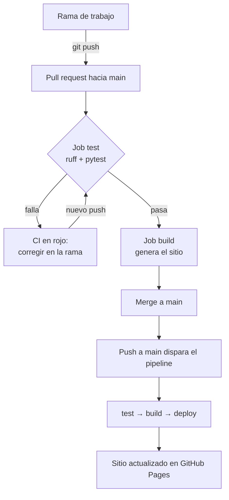

# Flujo DevOps del proyecto

Este documento explica cómo se versiona, se prueba y se despliega el scraper del iPhone 18 Pro
y 18 Pro Max de iShop Colombia. El objetivo es que cada cambio llegue a producción (el sitio en
GitHub Pages) solo después de pasar pruebas automáticas, y que todo quede trazable en GitHub.

## 1. Estrategia de ramas: GitHub Flow

- `main` siempre está estable y es lo que se publica.
- Cada cambio se hace en una rama corta con prefijo según su tipo, y entra a `main` solo por
  **pull request (PR)** con el pipeline en verde.
- Las PR se fusionan con *merge commit* para conservar el historial de cada rama.

| Rama | Propósito |
| --- | --- |
| `feature/refactor-scraper` | Pasar la lógica del notebook a módulos en `src/` |
| `test/pruebas-unitarias` | Pruebas con pytest sobre HTML real guardado |
| `ci/github-actions` | Pipeline de integración continua |
| `fix/precio-formato-colombiano` | Corrección detectada por una prueba (CI en rojo → verde) |
| `feature/sitio-resultados` | Generación del sitio estático con los resultados |
| `cd/github-pages` | Despliegue continuo en GitHub Pages |
| `docs/insignias` y `docs/devops` | Documentación (incluye un conflicto resuelto en el README) |

Se eligió GitHub Flow y no GitFlow porque el proyecto tiene un solo entorno publicado y
entregas pequeñas: no necesita ramas `develop` ni `release` de larga duración.

### Protección de `main`

En *Settings > Branches* la rama `main` exige PR antes de fusionar y que el check
**Pruebas y linting** termine en verde. No se exigen aprobaciones porque hay un solo autor y
GitHub no permite aprobar un PR propio.

## 2. Convención de commits: Conventional Commits

Formato `tipo(alcance): descripción en imperativo`. Tipos usados:

| Tipo | Uso | Ejemplo |
| --- | --- | --- |
| `feat` | Nueva funcionalidad | `feat(site): generar sitio estático con resultados` |
| `fix` | Corrección | `fix(scraper): aceptar precios en formato colombiano` |
| `test` | Pruebas | `test(scraper): cubrir precio ausente y mal formateado` |
| `ci` | Pipeline | `ci: agregar job de pruebas con ruff y pytest` |
| `refactor` | Reorganizar sin cambiar el comportamiento | `refactor(scraper): separar descarga y parseo` |
| `docs` | Documentación | `docs: documentar el flujo DevOps` |
| `chore` | Mantenimiento | `chore: commit inicial con el notebook de la EA1` |

## 3. Flujo completo

## 4. Pipeline: `.github/workflows/ci-cd.yml`

Se ejecuta en cada push a `main`, en cada PR hacia `main` y a mano (`workflow_dispatch`).
Los permisos por defecto son mínimos (`contents: read`) y solo el job de despliegue recibe
`pages: write` e `id-token: write`.

| Job | Depende de | Pasos | Resultado |
| --- | --- | --- | --- |
| `test` (Pruebas y linting) | — | checkout, Python 3.12 con caché de pip, `ruff check .`, `pytest --cov=src` | Falla si hay errores de estilo o alguna prueba no pasa |
| `build` (Generar sitio) | `test` | `python -m src.build_site`, `upload-pages-artifact` | Artefacto con `index.html` y `precios.png` |
| `deploy` (Desplegar en GitHub Pages) | `build` | `deploy-pages` | URL pública; solo corre en push a `main` |

En un PR corren `test` y `build` (integración continua); al fusionar en `main` corre además
`deploy` (despliegue continuo). El job `deploy` publica en el entorno `github-pages`, que
muestra en GitHub el historial de despliegues y la URL activa.

### Por qué las pruebas no usan internet

Las pruebas leen HTML real de iShop guardado en `tests/fixtures/`. Así el pipeline es rápido,
reproducible, no depende de que el sitio esté disponible y no genera tráfico innecesario.
La descarga HTTP está aislada en `obtener_html()`, que se prueba con una sesión falsa.

## 5. Cómo revertir un despliegue

1. **Revertir el merge (recomendado):** en el PR fusionado, botón **Revert**. GitHub crea un
   PR que deshace el cambio; al fusionarlo, el pipeline vuelve a desplegar la versión anterior.
   Por consola: `git revert -m 1 <sha-del-merge>` y `git push`.
2. **Volver a ejecutar un despliegue anterior:** en *Actions*, abrir la ejecución de la
   versión buena y usar **Re-run all jobs**.
3. **Versión etiquetada:** `v1.0.0` marca la primera versión estable y permite comparar o
   volver a ese punto.

## 6. Mejoras futuras

- **Docker:** imagen con Python y dependencias para ejecutar el scraper igual en cualquier
  máquina.
- **Ejecución programada:** un workflow con `schedule` que corra el scraper una vez al día,
  guarde el CSV con fecha y permita ver la evolución de precios.
- **Monitoreo:** alertas si el scraper extrae menos de 32 variantes o si cambia la estructura
  del sitio; métricas en Prometheus y Grafana.
- **Seguridad (DevSecOps):** Dependabot para actualizar dependencias y escaneo de código con
  CodeQL.
